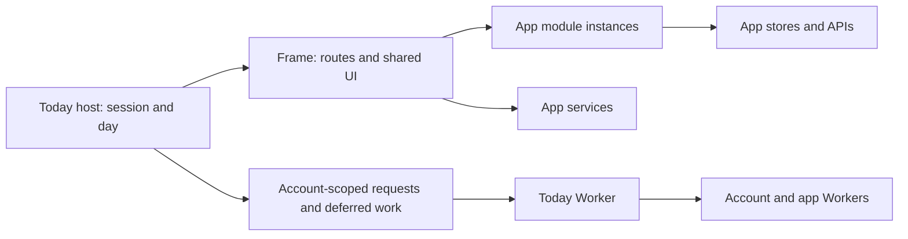

# Today and the InFlite framework

Today is the composition root for a signed-in InFlite window. The framework owns navigation and shared UI; app modules own their stores and domain behaviour; the Worker checks and forwards requests. There is no additional runtime dependency in this architecture pass.



## Responsibilities

| Boundary | Implementation | Owns |
| --- | --- | --- |
| Today host | `today/public/app.js`, `day.js`, `apps.js`, `you.js` | Session adoption, the day, built-in screens and notification settings |
| Frame | `today/public/roof/frame.js` | History, current route, screen visibility, shared UI and module/service lifetimes |
| Module loading | `today/public/roof/modules.js` | Contract validation, CSS readiness, recovery, version checks and offline installation |
| Screen tasks | `today/public/roof/screens.js` | Account/frame ownership and latest route/argument for lazy built-in screens |
| Deferred work | `today/public/roof/tasks.js` | Timers and idle callbacks owned by an AbortSignal |
| Today transport | `today/public/roof/requests.js` | In-flight GET sharing, request deadlines, cancellation and account reset |
| Worker transport | `today/src/upstream.js`, `body.js` | Bounded upstream header waits, cancellation and counted upload bytes |
| Worker routing | `today/src/index.js`, `hub.js`, `mailroof.js` | Route, origin, method, cookie and header policy |

The module descriptor remains in `roof/router.js`. Its entries, routes, connector files, styles and worker cache lists are checked across both repositories. Shared generated sign-in/menu blocks retain their existing source in the companion repository.

## Ownership and disposal

There are distinct lifetimes; do not substitute one for another.

| Lifetime | Ends when | Suitable work |
| --- | --- | --- |
| Account request scope | The host resets requests for a sign-in transition | Today reads/writes, delayed planning refreshes and account notification work |
| Frame (`F.signal`) | The signed-in frame is destroyed | Shared providers, service startup, framework-owned subscriptions |
| Module (`fw.signal`) | That module unmounts | App stores, long-lived subscriptions and delayed view construction |
| Visible episode | A module is hidden or a new route/section is shown | Delayed sheet opening, focus, navigation and other presentation effects |

`signedIn` destroys the previous account's frame before adopting a different account. It stops the old day and clears account-specific screen DOM. The paired boot response may then supply the new account's day; unrelated old responses cannot cross the reset.

Frame/module signals abort synchronously before teardown. Late imports cannot start a disposed module; a mount that returns after disposal has its instance unmounted exactly once. Framework handles captured by an old module become inert. A service that finishes starting after release is terminated without attaching host subscriptions.

Hiding a module preserves its store. Guard interactive lazy imports with a visible-episode token as well as the module lifetime; checking only `visible()` can let an old sheet open after leaving and returning. Data work needs a different policy: Fitness retains parsed file batches for the same account across section changes and defers their presentation until its screen is shown.

The contract version remains **1**. `F.signal`, `fw.signal` and service startup's `signal` are additive. Callers without the new field remain supported. The complete API is in [framework-contract.md](framework-contract.md).

## Startup and screen rendering

The session starts unknown. Only an authoritative signed-out response exposes sign-in controls; connection failures retain a neutral retry state or the eligible installed offline copy.

`createFrame` performs its initial route render synchronously. Today completes built-in Apps/You activation after receiving the frame, so cold deep links capture their actual owner. `createScreenTasks` then binds each lazy render to its account signal, frame, route object, route argument and latest task. You's subsequent settings responses, deep links and connector openers retain that ownership. Apps uses the account/frame check for existing editor callbacks so ordinary status refreshes preserve unfinished edits.

The framework waits for a module's required styles before mounting. A stylesheet error or five-second timeout enters the existing retry screen. Only failed links created by the loader are removed; healthy shared styles remain available to other instances.

## Requests and upstream boundaries

The page request coordinator shares only identical unfinished GETs. It does not cache completed account responses, retry uncertain writes or combine separate mutations. Each subscriber can cancel independently; account reset invalidates old transports and captured contexts. A cancelled or timed-out write may already have reached its server, so callers must check its outcome before retrying.

Deferred account work captures the request signal when scheduled. Reset cancels planning refresh timers and idle service starts; old callbacks cannot adopt a replacement account. Notification workflows also retain their initiating account across browser permission and subscription awaits.

Worker proxy code uses a shared upstream header deadline: 30 seconds for hub requests, 12 seconds for Mail module assets, and five seconds for the shared hub probe. Once headers arrive, downloads and range responses remain streamed; caller cancellation remains connected. No transport automatically retries writes. Identical pending hub probes share one request per configuration and do not share a visitor's cancellation signal.

`bodyUpTo` counts real bytes even with a declared Content-Length. Its raw mode preserves binary uploads; its text mode serves existing JSON endpoints. Original per-app upload caps remain in `hub.js`. Mail's version response is separately limited to 4 KiB and a five-second body read. Existing origin, path, cookie, content-type and header policy stays with the route layer.

## Assets and release checks

New core framework scripts belong in all three places: HTML module preloads where statically imported, Today's updater list, and the root service worker's shell list. Optional OS files are deliberately absent from the shared HTML preloads; they belong to the OS-only updater and service-worker lists instead. Account data does not belong in the shell cache. Cross-repository contracts check each framework script and module connector graph.

Run locally:

```sh
npm ci
npm ci --prefix email --omit=dev
npx playwright install chromium
npm test
```

With the companion `georgefarrowgreen` checkout beside `inflite`, run its framework/module, asset, worker and offline contracts:

```sh
cd ../georgefarrowgreen
npm ci --prefix .tools/tests
node --test --test-concurrency=4 .tools/tests/unit/roof*.test.mjs .tools/tests/unit/today*.test.mjs
```

The root Web UI workflow now runs these companion contracts on root framework changes as well as running its own request, proxy, lifecycle and browser suites. Browser fixtures cover interrupted imports/mounts, teardown, CSS failure/retry, account replacement, cold deep links and existing navigation, keyboard, draft and offline behaviour. They use synthetic accounts, not production mutations.

The executable core framework has a bounded **35 KiB gzip** budget. Workspace v1 adds about 1.5 KiB to the previous 33 KiB layer for controlled app views, pane visibility and navigation ownership; the measured core is about 34.0 KiB. The separately bounded request layer remains unchanged. The optional OS shell and both first-party adapters have a separate **24 KiB JS / 8 KiB CSS** served-gzip ceiling (about 22.1 / 5.9 KiB measured). These scripts are excluded from the core ceiling by an explicit five-file list, not a wildcard. Ordinary app first-open budgets remain Weather 90/14, Fitness 86/22 and Markets 40/12 KiB JS/CSS. Moving the API notes to this document set keeps them out of the executable files.

Workspace architecture, privacy boundaries and the optional asset contract are described in [workspaces.md](workspaces.md). The workspace-specific pure models, real-frame lifecycle fixtures and real-app composition browser suites complement the existing framework checks.
